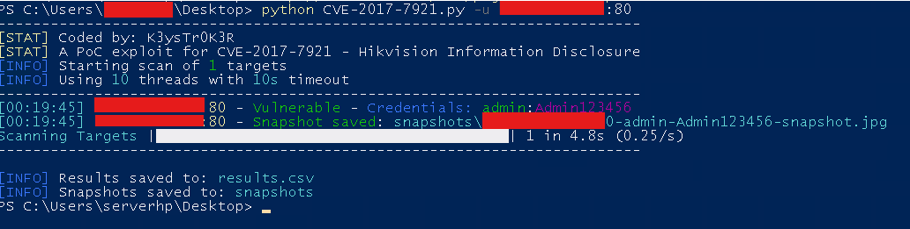

# 🛡️ CVE-2017-7921 — Étude de cas & sensibilisation

Ce dépôt documente, à des fins **pédagogiques et de sensibilisation à la
cybersécurité**, les conséquences possibles d'un équipement vulnérable à
**CVE-2017-7921** (vulnérabilité publique, divulguée en 2017, affectant
certains firmwares de caméras/enregistreurs Hikvision non mis à jour).

> ⚠️ **Avertissement légal**
>
> Toutes les démonstrations de ce dépôt ont été réalisées **dans un
> environnement de test autorisé**, à des fins exclusivement éducatives, de
> recherche et de sensibilisation. Avant publication, **toutes les
> informations sensibles** (identifiants, mots de passe, adresses IP, numéros
> de série, noms d'hôtes, etc.) ont été **anonymisées ou floutées**.
>
> Ce dépôt ne constitue **ni un guide d'exploitation, ni une incitation** à
> agir contre des systèmes appartenant à des tiers. Toute utilisation doit
> s'inscrire dans un cadre légal, éthique, et avec l'autorisation explicite du
> propriétaire des équipements concernés.

## 📋 Sommaire

- [Contexte](#-contexte)
- [Rapport de prévention](#-rapport-de-prévention)
- [Illustrations](#-illustrations)
- [Objectif pédagogique](#-objectif-pédagogique)
- [Licence](#-licence)

---

## 📚 Contexte

**CVE-2017-7921** est une vulnérabilité publique affectant certains firmwares
d'équipements Hikvision, référencée sur la
[base nationale des vulnérabilités (NVD)](https://nvd.nist.gov/vuln/detail/CVE-2017-7921).
Un équipement exposé sur Internet et non mis à jour peut potentiellement
divulguer des informations sensibles ou permettre un accès non autorisé à son
interface d'administration.

Ce dépôt n'a pas vocation à détailler la mécanique d'exploitation, mais à
illustrer **pourquoi** ce type de vulnérabilité est critique et **comment** s'en
protéger (mise à jour du firmware, segmentation réseau, non-exposition directe
des interfaces d'administration sur Internet).

## 📄 Rapport de prévention

Un rapport technique détaillé accompagne ce dépôt. Il présente notamment :

- une description de la vulnérabilité **CVE-2017-7921** ;
- les produits et versions concernés ;
- les risques liés à l'exposition d'un équipement vulnérable ;
- les impacts potentiels sur la confidentialité, l'intégrité et la
  disponibilité des systèmes ;
- les recommandations de mitigation et les bonnes pratiques de sécurisation.

**➡️ [Rapport de prévention – CVE-2017-7921](Rapport_Prevention_CVE-2017-7921.pdf)**

## 📷 Illustrations

Les captures ci-dessous ont été réalisées **dans un environnement de
démonstration autorisé**. Tous les éléments permettant d'identifier un système
réel (identifiants, IP, propriétaire…) ont été **anonymisés ou floutés avant
publication**. Elles ne constituent pas un mode d'emploi, mais une
représentation visuelle de l'impact potentiel d'un équipement non mis à jour.

### Illustration n°1 — Exemple de récupération d'informations

Exemple du type d'informations qui peuvent être exposées lorsqu'un équipement
affecté par CVE-2017-7921 n'a pas été correctement mis à jour ou sécurisé.

  

### Illustration n°2 — Interface d'administration

Interface d'administration d'un équipement, dans un environnement de
démonstration autorisé. Objectif : illustrer les conséquences d'une
vulnérabilité non corrigée sur un équipement exposé sans mesures de sécurité
appropriées.

  

## 🎯 Objectif pédagogique

Ces ressources visent à sensibiliser administrateurs, chercheurs en sécurité
et étudiants aux conséquences d'une vulnérabilité comme CVE-2017-7921 lorsqu'elle
n'est pas corrigée. Elles illustrent concrètement :

- les informations susceptibles d'être exposées sur un équipement vulnérable ;
- les conséquences d'une configuration insuffisamment sécurisée ;
- l'importance d'appliquer les correctifs publiés par les fabricants ;
- la nécessité de maintenir les firmwares à jour et de limiter l'exposition
  des interfaces d'administration sur Internet ;
- l'intérêt d'audits réguliers pour identifier les équipements vulnérables
  avant qu'ils ne soient compromis.

## 📄 Licence

Distribué sous licence [MIT](LICENSE).
